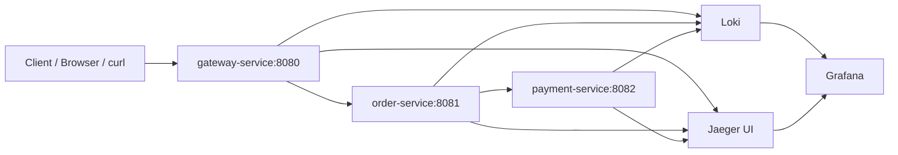

# Architecture Overview

This document describes the structure, responsibilities, and observability flow of the distributed tracing demo.

---

## 1. System context

The project demonstrates a simple but realistic microservice chain with observability instrumentation across each hop.

Users send requests to the gateway, which calls the order service, which in turn calls the payment service. Every hop emits telemetry: spans for traces and structured logs for log aggregation.



---

## 2. Service responsibilities

### gateway-service

- Entry point for client requests
- Exposes endpoint: `/gateway`
- Creates a gateway span
- Injects `traceparent` header when forwarding to downstream service
- Calls `order-service` via `RestClient`

### order-service

- Business processing service
- Exposes endpoint: `/orders`
- Creates order business span
- Calls `payment-service`
- Logs trace metadata with MDC

### payment-service

- Payment simulation service
- Exposes endpoint: `/payments`
- Creates payment span
- Returns successful order payment result

---

## 3. Request flow

A typical request path is:

```text
GET /gateway?userId=u123
  -> gateway-service
      -> create span "gateway.createOrder"
      -> HTTP GET http://localhost:8081/orders?userId=u123
          -> order-service
              -> create span "order.controller.createOrder"
              -> HTTP GET http://localhost:8082/payments?orderId=ORD-... 
                  -> payment-service
                      -> create span "payment.process"
                      -> return success
              -> return order response
      -> return aggregated response to client
```

This example is intentionally simple but representative of layered service-to-service communication in production.

---

## 4. Trace propagation design

The key part of distributed tracing is propagating context across process boundaries.

### Mechanism

The gateway builds the current W3C traceparent header using the active OTel span:

```java
private String currentTraceParent() {
    Span current = Span.current();
    if (!current.getSpanContext().isValid()) {
        return "00-00000000000000000000000000000000-0000000000000000-01";
    }
    return "00-" + current.getSpanContext().getTraceId() + "-" + current.getSpanContext().getSpanId() + "-01";
}
```

Then it sends this header on the downstream request:

```java
.header("traceparent", currentTraceParent())
```

This allows downstream services to continue the same trace instead of starting a new one.

### Result

In Jaeger, you should see a single trace tree containing spans from:

- `gateway.createOrder`
- `order.controller.createOrder`
- `payment.process`

---

## 5. Observability pipeline

### Traces

Each Spring Boot service exports spans to Jaeger via OTLP.

Configuration example:

```properties
management.tracing.enabled=true
management.tracing.sampling.probability=1.0
otel.exporter.otlp.endpoint=http://localhost:4318
otel.exporter.otlp.protocol=http/protobuf
```

### Logs

Each service writes logs with MDC values:

- traceId
- spanId

The application config uses Logback and the JSON encoder from Logstash.

Example pattern:

```xml
<property name="LOG_PATTERN" value="%d{yyyy-MM-dd HH:mm:ss.SSS} %5p [${APP_NAME}] traceId=%X{traceId:-NA} spanId=%X{spanId:-NA} %logger{36} - %msg%n"/>
```

Logs are written to both console and `/tmp/spring-boot.log`.

### Log aggregation

Promtail reads `/tmp/spring-boot.log` and pushes entries to Loki.

```yaml
clients:
  - url: http://loki:3100/loki/api/v1/push

scrape_configs:
  - job_name: spring-boot
    static_configs:
      - targets:
          - localhost
        labels:
          job: spring-boot
          __path__: /tmp/spring-boot.log
```

Then Grafana queries Loki to display logs.

---

## 6. Telemetry stack

### Jaeger

Purpose:
- view distributed traces
- inspect span timing
- validate propagation and parent-child relationships

Access:
- http://localhost:16686

### Loki

Purpose:
- store structured logs from app services
- support log filtering using labels and trace metadata

Access:
- http://localhost:3100

### Grafana

Purpose:
- visualize logs from Loki
- connect logs and traces in one dashboarding layer
- optionally add custom dashboards for service health and request volume

Access:
- http://localhost:3000

### Prometheus

Purpose:
- scrape Micrometer metrics from Actuator endpoints
- support monitoring and alerting for service metrics

Access:
- http://localhost:9090

---

## 7. Project layering

The project is organized around clear responsibilities:

- application layer: business logic and HTTP endpoints
- telemetry layer: OTel configuration and trace context management
- transport layer: RestClient calls between services
- collection layer: Prometheus, Loki, Jaeger, Grafana

This separation makes the demo easy to understand and extend.

---

## 8. Dependency flow

Main dependencies in each service include:

```gradle
implementation 'org.springframework.boot:spring-boot-starter-web'
implementation 'org.springframework.boot:spring-boot-starter-actuator'
implementation 'io.micrometer:micrometer-tracing'
implementation 'io.micrometer:micrometer-tracing-bridge-otel'
implementation 'io.micrometer:micrometer-registry-prometheus'
implementation 'io.opentelemetry:opentelemetry-exporter-otlp'
implementation 'net.logstash.logback:logstash-logback-encoder:8.0'
```

These packages are enough to:
- emit spans
- export telemetry to OTLP
- expose metrics
- provide structured log encoding

---

## 9. Why this architecture is useful

This pattern is representative of real-world microservice systems because it covers:

- service-to-service communication
- tracing across boundaries
- request correlation via IDs
- central log collection
- system visibility in a single dashboard layer

It is a good baseline for:
- platform engineering
- observability implementation
- microservice architecture learning
- production readiness exercises

---

## 10. Typical validation steps

To validate the whole system, the normal flow is:

1. Start Docker stack
2. Start `order-service`
3. Start `gateway-service`
4. Start `payment-service`
5. Call `/gateway?userId=u123`
6. Open Jaeger and verify the trace tree
7. Open Grafana and query Loki for the same traceId
8. Validate that all logs and spans match the same request

---

## 11. Failure patterns and lessons

Common issues in this setup:

- service not running on expected port
- missing `RestClient.Builder` bean
- no OTLP exporter endpoint available
- app logs not reaching Loki because the file path is wrong
- missing `traceparent` header causing disconnected spans

These are exactly the types of issues that distributed tracing helps reveal quickly in real production systems.

---

## 12. Summary

This project is a compact but production-like example of observability in a three-service architecture. It combines:

- distributed tracing
- log aggregation
- metrics exposure
- service correlation
- central visual analysis

It is useful both as a learning project and as a practical pattern for real microservice observability setups.
