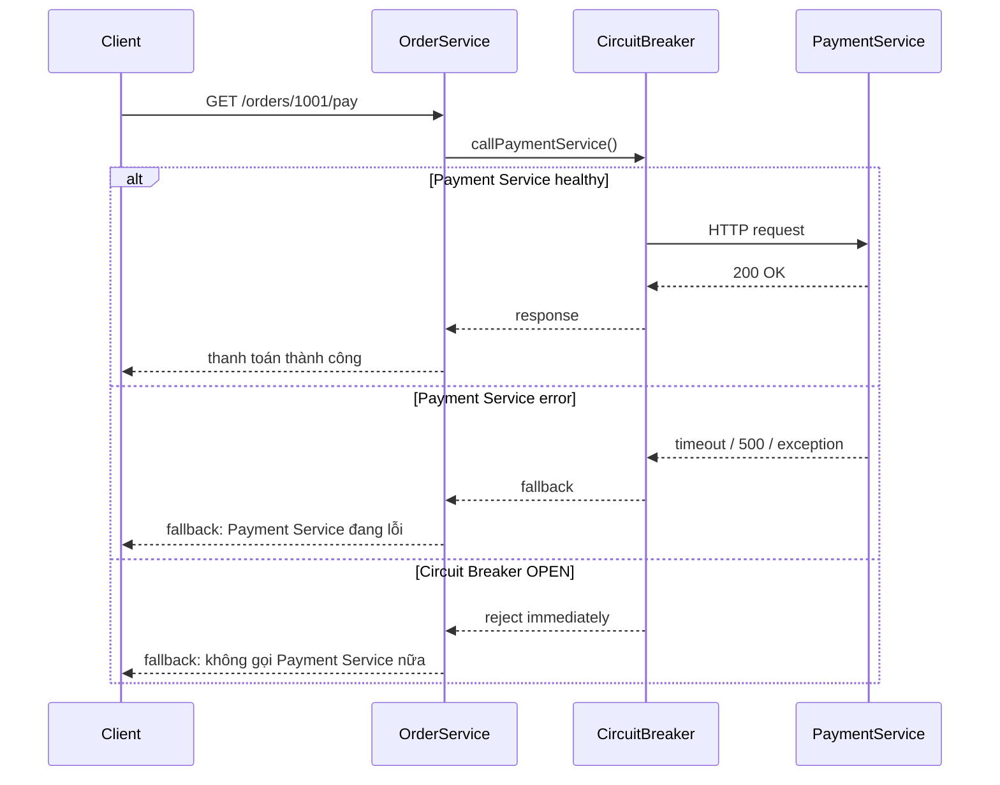

# Circuit Breaker demo

## 1. Mô hình microservice

Order Service -> Payment Service

- Order Service gọi Payment Service thông qua `PaymentServiceClient`.
- Payment Service có thể bị lỗi hoặc chậm.
- Circuit Breaker nằm ở phía Order Service để chặn các request tiếp theo khi Payment Service lỗi quá mức.
- Mục tiêu: tránh lỗi lan từ Payment Service sang Order Service và các service khác.

## 2. Flow hoạt động



## 3. Trạng thái Circuit Breaker

- CLOSED: hệ thống hoạt động bình thường, request được chuyển đi như thường.
- OPEN: đã phát hiện lỗi liên tục, hệ thống tạm thời ngắt request sang Payment Service để bảo vệ.
- HALF_OPEN: sau khoảng thời gian chờ, thử một số request nhỏ để kiểm tra xem Payment Service đã phục hồi chưa.

## 4. Cấu hình hiện tại

Trong [src/main/java/com/example/circuite_breaker/ResilienceCircuitBreakerConfig.java](src/main/java/com/example/circuite_breaker/ResilienceCircuitBreakerConfig.java), circuit breaker đang cấu hình với:

- slidingWindowSize = 5
- minimumNumberOfCalls = 5
- failureRateThreshold = 50%
- waitDurationInOpenState = 10 giây
- permittedNumberOfCallsInHalfOpenState = 2
- automaticTransitionFromOpenToHalfOpenEnabled = true

## 5. Endpoint demo

- `/orders/{orderId}/pay`: Order Service gọi Payment Service
- `/status`: xem trạng thái hiện tại của circuit breaker

## 6. Chạy ứng dụng

Từ thư mục project:

```bash
./gradlew bootRun
```

Sau khi ứng dụng chạy, mở các URL sau:

```bash
curl http://localhost:8080/orders/1001/pay
curl http://localhost:8080/status
```

## 7. Test case thành công

Mục tiêu: Payment Service trả thành công và không có fallback.

Trong test, mock `RestTemplate` trả HTTP 200 JSON:

```java
server.expect(requestTo("https://example.com/payments/charge"))
      .andRespond(withSuccess("{\"status\":\"OK\"}", MediaType.APPLICATION_JSON));
```

Kiểm tra:

```java
assertThat(response).contains("OK");
assertThat(response).doesNotContain("fallback");
```

## 8. Test case thất bại

Mục tiêu: Payment Service trả lỗi 500, Circuit Breaker trả fallback.

```java
server.expect(requestTo("https://example.com/payments/charge"))
      .andRespond(withServerError());
```

Kiểm tra:

```java
assertThat(response).contains("fallback");
assertThat(response).contains("Order Service");
```

## 9. Test case OPEN và HALF_OPEN

Khi Payment Service lỗi liên tiếp nhiều lần, circuit breaker sẽ chuyển sang OPEN.
Sau khi hết thời gian chờ (`waitDurationInOpenState`), nó tự động chuyển sang HALF_OPEN để thử lại một phần.

Ví dụ test:

```java
CircuitBreaker circuitBreaker = CircuitBreaker.of("half-open-demo",
        CircuitBreakerConfig.custom()
                .slidingWindowSize(2)
                .minimumNumberOfCalls(2)
                .failureRateThreshold(50.0f)
                .waitDurationInOpenState(Duration.ofMillis(100))
                .permittedNumberOfCallsInHalfOpenState(2)
                .automaticTransitionFromOpenToHalfOpenEnabled(true)
                .build());
```

Sau đó:

```java
assertThat(circuitBreaker.getState()).isEqualTo(CircuitBreaker.State.OPEN);
Thread.sleep(300L);
assertThat(circuitBreaker.getState()).isEqualTo(CircuitBreaker.State.HALF_OPEN);
```

## 10. Chạy test

```bash
./gradlew test --no-daemon
```

Nếu muốn chạy một test cụ thể:

```bash
./gradlew test --tests "com.example.circuite_breaker.CircuitBreakerDemoControllerTest"
```

## 10. Ý nghĩa thực tế

Circuit Breaker rất quan trọng trong microservice vì nó:

- ngăn request tiếp tục đi vào service đang lỗi,
- tránh thời gian chờ và tài nguyên bị lãng phí,
- giữ cho Order Service vẫn có thể phản hồi thay vì treo hoàn toàn,
- giảm rủi ro lỗi lan từ dependency xuống hệ thống chính.
